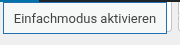
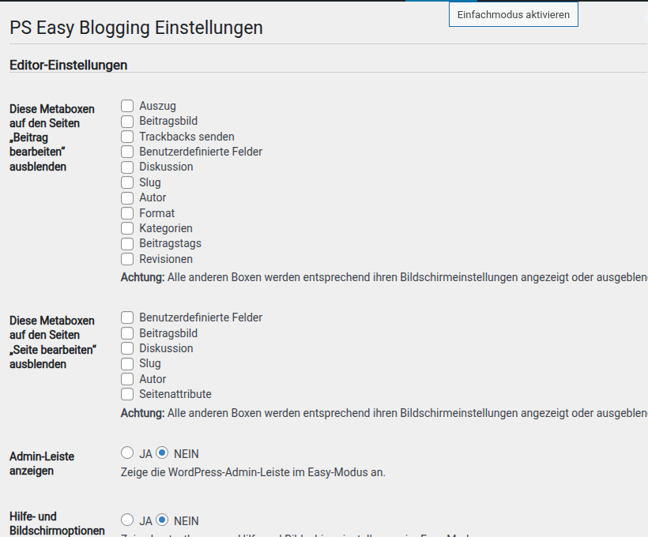
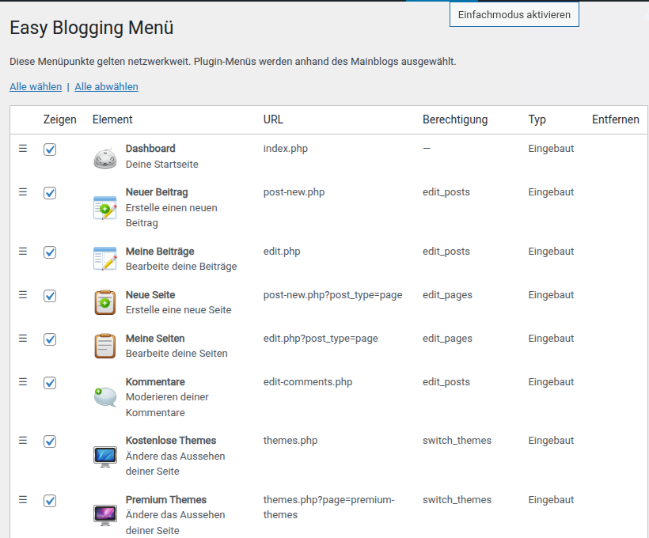
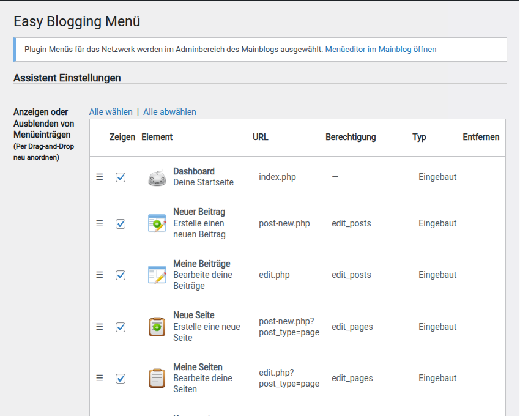
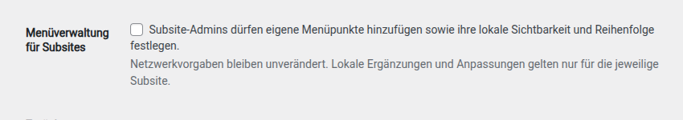

# PS Easy Blogging – Bedienungsanleitung

Diese Anleitung richtet sich an Website-Administratoren und Netzwerkadministratoren. Sie beschreibt die wichtigsten Einstellungen, den Wechsel zwischen Easy- und erweitertem Modus sowie die Menüverwaltung.

## 1. Easy- und erweiterten Modus wechseln

Im ClassicPress-Adminbereich befindet sich oben rechts der Umschalter. Ein Klick auf **Einfachmodus aktivieren** öffnet die vereinfachte Ansicht. Im Easy-Modus kann über **Easy-Modus verlassen** wieder zur erweiterten Ansicht gewechselt werden.

Der Umschalter kann auch in der Admin-Leiste unter dem Website-Menü erscheinen. Wenn ein Administrator den Easy-Modus für eine Benutzerrolle erzwingt, wird die Wechselmöglichkeit für diese Benutzer ausgeblendet.

## 2. Grundeinstellungen

Öffne **Easy Blogging → Easy Blogging**. Auf dieser Seite werden die wichtigsten Einstellungen für den Easy-Modus verwaltet.

Je nach ClassicPress-Version und installierten Erweiterungen stehen unter anderem folgende Optionen zur Verfügung:

- **Editor-Einstellungen:** Metaboxen beim Bearbeiten von Beiträgen und Seiten ausblenden.
- **Admin-Leiste und Bildschirmoptionen:** festlegen, ob diese Elemente im Easy-Modus angezeigt werden.
- **Easy Bar:** die dauerhaft verfügbare Easy Bar ein- oder ausblenden.
- **Rolle erzwingen:** ausgewählte Benutzerrollen immer im Easy-Modus öffnen. Betroffene Benutzer können den Modus nicht selbst verlassen.
- **Startseite für neue Benutzer:** neuen Benutzern beim ersten Anmelden die Wahl zwischen Easy- und erweitertem Modus anbieten.
- **Design und Logo:** ein Farbschema und optional ein eigenes Logo wählen.
- **Dashboard-Widget:** das Easy-Blogging-Widget und dessen Inhalt konfigurieren.

Änderungen werden mit **Änderungen speichern** übernommen.

## 3. Assistent und Tooltips

Unter **Easy Blogging → Easy Blogging Assistent** kann der Assistent aktiviert und seine Schrittfolge angepasst werden. Schritte lassen sich neu anordnen, bearbeiten oder entfernen. Beim Hinzufügen eines Schrittes werden Ziel-URL, Titel und Hilfetext eingetragen.

Unter **Easy Blogging → Easy Blogging Tooltips** kann die Tooltip-Hilfe ein- oder ausgeschaltet werden.

## 4. Erweiterungen

Unter **Easy Blogging → Erweiterungen** können verfügbare Easy-Blogging-Erweiterungen aktiviert oder deaktiviert werden. Welche Erweiterungen erscheinen, hängt von der Installation und dem Aktivierungsumfang ab. Die PS-Bloghosting-Erweiterung wird beispielsweise nur angeboten, wenn Easy Blogging netzwerkweit und PS Bloghosting im Netzwerk aktiviert ist.

## 5. Menüeinträge im Easy-Modus verwalten

Öffne **Easy Blogging → Menüeinträge**. Die Tabelle zeigt, welche Einträge im Easy-Modus sichtbar sind. Über das Kontrollkästchen wird ein Eintrag ein- oder ausgeblendet; am Ziehgriff lässt sich die Reihenfolge ändern. Speichere die Änderungen anschließend mit **Änderungen speichern**.

### Vorgegebene Menüeinträge anpassen

Bei den eingebauten Menüeinträgen lässt sich **Bearbeiten** öffnen, um Titel, Hilfetext, URL, Icon und erforderliche Berechtigung anzupassen. Die Änderungen werden im jeweiligen Menüeditor gespeichert. Bei Netzwerkaktivierung bearbeitest du die netzwerkweiten Vorgaben im Mainblog; Subsite-Admins können diese Vorgaben nicht überschreiben.

Die Berechtigung steuert nur, für wen der Menüeintrag angezeigt wird. Sie erteilt keine zusätzlichen Zugriffsrechte auf die Zielseite. Die ursprüngliche Zuordnung des Menüeintrags bleibt erhalten, sodass gespeicherte Sichtbarkeit und Reihenfolge nach einer Bearbeitung weiter gelten.

### Vorhandene Plugin-Menüs übernehmen

Im Formular **Menüpunkt hinzufügen** kannst du ein vorhandenes Admin-Menü aus der Auswahlliste übernehmen. Titel, URL, Icon und Berechtigung werden vorausgefüllt und können vor dem Hinzufügen angepasst werden. Es erscheinen nur Menüs, auf die das aktuell angemeldete Konto Zugriff hat.

Alternativ kannst du einen Menüpunkt manuell anlegen. Trage Titel und URL ein, wähle ein Icon, ergänze bei Bedarf einen Hilfetext und lege die erforderliche Berechtigung fest. Für Berechtigungen außerhalb der angebotenen Rollenwerte kann das Berechtigungsfeld manuell ausgefüllt werden.

## 6. Menüverwaltung in Multisite-Netzwerken

Die verfügbaren Menüs und Speicherorte hängen davon ab, wie Easy Blogging aktiviert wurde:

### Nur auf einer Website aktiviert

Die Einstellungen und Menüeinträge gelten für diese Website. Website-Administratoren mit den erforderlichen Rechten verwalten sie im Website-Adminbereich.

### Netzwerkweit aktiviert

Die gemeinsamen Easy-Blogging-Einstellungen werden in der Netzwerkverwaltung gepflegt. Netzwerkweite Menüvorgaben werden anhand der registrierten Menüs des **Mainblogs** zusammengestellt. Der Menüeditor für diese Vorgaben befindet sich im Adminbereich des Mainblogs unter **Einstellungen → Easy Blogging Menü**.

In **Netzwerkverwaltung → Easy Blogging → Menüeinträge** können Netzwerkadministratoren außerdem erlauben, dass Subsite-Admins lokale Menüpunkte ergänzen und die lokale Sichtbarkeit sowie Reihenfolge anpassen. Ein Hinweis auf dieser Seite führt zum Menüeditor im Mainblog.

Aktiviere dazu im Abschnitt **Menüverwaltung für Subsites** das Kontrollkästchen und speichere die Änderungen. Die Abbildung zeigt diesen Schalter; im Testsystem ist er nicht aktiviert.

Nach der Freigabe finden Subsite-Admins **Einstellungen → Easy Blogging Menü** im Adminbereich ihrer Website. Änderungen dort gelten ausschließlich für diese Subsite:

- Lokale Menüpunkte können hinzugefügt werden.
- Netzwerkweit sichtbare Einträge können auf der jeweiligen Subsite ausgeblendet werden.
- Die Reihenfolge kann lokal angepasst werden.
- Netzwerkvorgaben und andere Subsites bleiben unverändert.
- Ein netzwerkweit ausgeblendeter Eintrag kann von einer Subsite nicht wieder eingeblendet oder gelöscht werden.

Die Auswahl vorhandener Plugin-Menüs auf einer Subsite basiert auf den Menüs, die dort registriert sind. Für netzwerkweite Vorgaben muss die Auswahl im Mainblog erfolgen.

## 7. Wenn eine Einstellung oder ein Menü fehlt

- **Easy Blogging ist nicht im Menü sichtbar:** Prüfe, ob das Plugin auf dieser Website oder im Netzwerk aktiviert ist und ob dein Konto die erforderlichen Administratorrechte hat.
- **Die lokale Menüverwaltung fehlt auf einer Subsite:** Ein Netzwerkadministrator muss sie zuerst in der Netzwerkverwaltung freischalten.
- **Der Netzwerk-Menüeditor ist nicht erreichbar:** Dafür sind Netzwerkadministratorrechte erforderlich. Die Netzwerkvorgaben werden im Mainblog bearbeitet.
- **Ein Plugin-Menü erscheint nicht in der Auswahlliste:** Stelle sicher, dass das Plugin auf der betreffenden Website beziehungsweise im Mainblog aktiv ist und dein Konto auf dessen Menü zugreifen darf.
- **Der Modus lässt sich nicht verlassen:** Ein Administrator kann den Easy-Modus für deine Benutzerrolle erzwingen.

> **Hinweis zu den Screenshots:** Die Bilder stammen aus dem Testsystem. Der Subsite-Menüeditor ist nicht abgebildet, da das aktuelle Konto trotz Netzwerkaktivierung keinen Zugriff auf die Website „Hurra Demo“ hat. Es wurden dafür keine Website-Einstellungen geändert.
